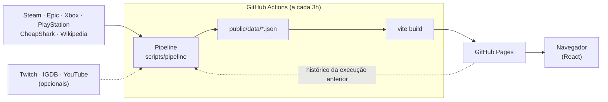

# Pulso · o pulso do mundo dos games

Painel em português com tudo o que está acontecendo nos games, atualizado automaticamente:

- **Mais jogados**: top 100 da Steam por jogadores simultâneos, com variação de posição e gráfico dos últimos 7 dias.
- **Lançamentos**: calendário do ano atual e do próximo (mais de 800 jogos), com filtros por plataforma e os mais aguardados.
- **Promoções**: Steam, Xbox e PlayStation (preços em R$), jogos grátis da Epic e ofertas de GOG, Humble, Fanatical, Green Man Gaming e outras lojas.
- **Em alta**: o *Índice Pulso*, que cruza jogadores ao vivo, mais vendidos e audiência na Twitch, mais os vídeos de games em alta no YouTube.
- **Premiações**: The Game Awards, BAFTA Games Awards e D.I.C.E. Awards, com indicados, vencedores e os mais indicados. Os indicados de uma cerimônia futura aparecem sozinhos assim que são publicados.
- **Detalhes do jogo**: clique em qualquer jogo para ver jogadores, preços em todas as lojas, data de lançamento, prêmios e lives.
- **Favoritos**, busca global (`Ctrl K` ou `/`), tema claro/escuro e layout para celular.

## Como funciona

O GitHub Pages só hospeda arquivos estáticos, então o "backend" é um pipeline de dados que roda no GitHub Actions a cada 3 horas. Ele consulta as fontes, cruza os jogos entre elas e gera arquivos JSON que funcionam como a API do site.



- **Histórico sem banco de dados**: a cada execução, o pipeline lê os JSON já publicados no site para continuar o histórico de jogadores (os gráficos de 7 dias) e reaproveitar as capas já encontradas.
- **Tolerância a falhas**: cada fonte roda isolada. Se uma falhar, o site mantém os dados anteriores dela e o rodapé mostra o status de cada fonte.
- **Cruzamento de fontes**: os nomes dos jogos são normalizados ("Cyberpunk 2077: Ultimate Edition" vira `cyberpunk 2077`), e é isso que permite mostrar, no mesmo painel, os jogadores da Steam, o preço no Xbox e as indicações ao TGA.

### Fontes de dados

| Fonte | O que traz | Precisa de chave? |
| --- | --- | --- |
| Steam (APIs públicas e busca da loja) | Jogadores simultâneos, mais vendidos, promoções em R$, mais desejados e capas | Não |
| Epic Games Store | Jogos grátis da semana e os próximos | Não |
| Xbox Store (xbox.com) | Ofertas em R$ e jogos populares | Não |
| PlayStation Store | Ofertas em R$ e mais vendidos de PS5 | Não |
| CheapShark | Ofertas de GOG, Humble, Fanatical, GMG, Ubisoft e outras (em US$) | Não |
| Wikipedia | Calendário de lançamentos e premiações (TGA, BAFTA, D.I.C.E.) | Não |
| Twitch | Jogos mais assistidos e streamers ao vivo | Sim, grátis |
| IGDB | Jogos mais aguardados ("hype"), artes e resumos | Usa a mesma chave da Twitch |
| YouTube Data API | Vídeos de games em alta (BR e EUA) | Sim, grátis |

Sem nenhuma chave, o site já funciona com 15 fontes. As opcionais completam as seções de streamers e criadores.

## Publicar no GitHub Pages

1. Crie um repositório no GitHub (por exemplo, `pulso-games`) e envie este projeto:
   ```bash
   git init -b main
   git add .
   git commit -m "Pulso: painel de games"
   git remote add origin https://github.com/SEU-USUARIO/pulso-games.git
   git push -u origin main
   ```
2. No repositório, vá em **Settings → Pages** e, em *Build and deployment → Source*, escolha **GitHub Actions**.
3. Abra a aba **Actions** e rode o workflow **Atualizar dados e publicar** (ou espere o primeiro push terminar).
4. O site fica em `https://SEU-USUARIO.github.io/pulso-games/` e se atualiza sozinho a cada 3 horas.

### Ativar Twitch, IGDB e YouTube (opcional)

Em **Settings → Secrets and variables → Actions → New repository secret**, cadastre:

| Segredo | Onde conseguir |
| --- | --- |
| `TWITCH_CLIENT_ID` e `TWITCH_CLIENT_SECRET` | [dev.twitch.tv/console/apps](https://dev.twitch.tv/console/apps): crie um app com categoria "Website Integration" e OAuth Redirect `http://localhost` |
| `YOUTUBE_API_KEY` | [Google Cloud Console](https://console.cloud.google.com/apis/library/youtube.googleapis.com): ative a *YouTube Data API v3* e crie uma chave de API |

Na próxima execução do workflow, as seções de Twitch, YouTube e "mais aguardados" do IGDB passam a aparecer.

> **Domínio próprio?** Crie a variável de repositório `SITE_URL` (por exemplo, `https://games.seudominio.com`) para o pipeline encontrar os dados publicados e manter o histórico.

## Rodar localmente

Requer Node.js 22 ou superior.

```bash
npm install
```

```bash
npm run data
```

```bash
npm run dev
```

`npm run data` coleta tudo de novo (leva cerca de 2 minutos) e grava em `public/data/`. Para testar as fontes opcionais, copie `.env.example` para `.env` e preencha as chaves. `npm run build` gera o site final em `dist/`.

## Estrutura

```
scripts/pipeline/
  index.ts            orquestra a coleta, cruza as fontes e grava os JSON
  config.ts           premiações acompanhadas, datas de cerimônias e ajustes manuais
  sources/            um módulo por fonte (steam, epic, xbox, playstation, cheapshark, twitch, igdb, youtube, wikipedia)
  lib/                cliente HTTP com novas tentativas, normalização de nomes, parser de wikitext
src/
  types.ts            contrato dos JSON (compartilhado entre pipeline e site)
  pages/              Início, Mais jogados, Lançamentos, Promoções, Em alta, Premiações, Favoritos
  components/         cartões, painel de detalhes, busca global, layout
  lib/                carregamento de dados, índice de jogos, formatação pt-BR, favoritos, tema
public/data/          dados gerados (também servem de ponto de partida no primeiro deploy)
.github/workflows/    coleta agendada e publicação no GitHub Pages
```

## Personalizar

- **Frequência de atualização**: altere o `cron` em `.github/workflows/deploy.yml`.
- **Premiações**: edite `awardEvents()` e `CEREMONY_DATES` em `scripts/pipeline/config.ts`.
- **Capa errada ou faltando**: adicione uma entrada em `OVERRIDES` (`config.ts`) com o `steamAppId` ou a URL da imagem.
- **Cores e fontes**: os tokens de design ficam no topo de `src/styles.css` (tema escuro e claro).

## Limitações conhecidas

- Jogos fora da Steam (Fortnite, Minecraft, Roblox, League of Legends) não publicam número de jogadores em tempo real. Eles aparecem pela audiência na Twitch e pelos rankings das lojas.
- Xbox e PlayStation não têm API pública oficial de ofertas. O pipeline lê os mesmos dados que os sites das lojas usam, então pode precisar de ajuste se elas mudarem o formato. Se o hash da consulta da PS Store mudar, defina `PS_GRID_HASH` no workflow.
- Lojas do CheapShark mostram preços em dólar.
- O GitHub pausa workflows agendados depois de 60 dias sem atividade no repositório. Se isso acontecer, reative em **Actions**.

Pulso não é afiliado à Valve, Epic Games, Microsoft, Sony, Twitch, Google ou à The Game Awards. Marcas e imagens pertencem aos respectivos donos.
